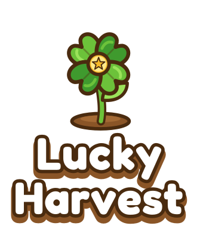

<p align="center"></p>

# Lucky Harvest 🌾

A nostalgic isometric 3D farming game, inspired by *Happy Harvest* from the Orkut days.
Everything you see is modeled procedurally in code: no external art assets.

**Stack:** TypeScript · Vite · Three.js · Vitest

## Run it

```bash
npm install
npm run dev                # http://localhost:5173
npm run dev -- --host      # also reachable from your phone on the same Wi-Fi
npm run build              # typecheck + production build
npm test                   # game-logic and render smoke tests
```

Pushes to `main` deploy to GitHub Pages (Settings → Pages → Source: GitHub Actions).

## How to play

You start with 100 coins, a few seeds and a 6×6 plot.

1. **Arar:** tap grass inside the bright plot to plow it into soil.
2. **Semear:** pick a seed from the tray and tap plowed soil. Seeds come from your inventory (the number under each seed); buy more at the **Loja**.
3. **Regar:** water the crop. An unwatered crop stalls at halfway (blue droplet) and wilts if left too long.
4. **Cuidar:** weeds and bugs can show up while a crop grows (red alert). They freeze its growth until you pull or shoo them with the glove, and the crop wilts if ignored.
5. **Colher:** when a gold coin spins over the crop, tap it. The harvest goes to your barn.
6. **Limpar:** clears withered crops, or turns bare soil back to grass.
7. **Sound and time:** the speaker button mutes everything. A day lasts 8 real minutes, and at night the windows light up and fireflies come out.
8. **Loja:** buy seeds (**Sementes**) and animal feed (**Ração**), sell crops and animal products (**Vender**), build pens and buy animals (**Animais**), and expand the plot and buy truck upgrades and decorations (**Fazenda**: plot 6×6, 8×8, 10×10, 12×12).
9. **Celeiro:** tap the barn to see everything you own, and to mill feed from your crops for free (2 trigo → 3 rações de galinha, 2 milho → 2 de vaca, 3 tomate → 2 de porco).
10. **Animais:** each species lives in its own pen (Galinheiro Nv 2, Curral Nv 4, Chiqueiro Nv 6) on the east side of the island. Tap a pen to feed its animals with the matching feed, wait out the timer, and collect eggs, milk or truffles. Pens upgrade to tiers 2 and 3 (Nv 9 and 15): more room and a faster cycle.
11. **Olhar:** the neutral tool (default). It never changes anything: tap or hover a tile or building to read what it is. Every other tool shows its own icon as the cursor.
12. **Ajudantes (Loja):** five helpers that work by themselves and charge every 10 minutes (taken automatically; if you can't pay, they stop and show a crossed-out coin until you pay them). People charge a *salário*, the animals a *custo*:
    - **Regador do moinho** (Nv 3): sprinkler heads across the plot water thirsty crops. Each level switches on a third of a lattice that covers every tile, so level 3 waters the whole plot at any land size, and pulses get faster.
    - **Tonico, o ajudante** (Nv 5): a farmhand who walks to the nearest ripe crop, pulls it and tosses it in his basket. **Level 4** (Nv 14 to buy, 9.000 moedas) makes him plow, sow and water too, configured in **Configurar** (shop) or by tapping him: master switch, mode (best profit, list order, or random mix), allowed seeds, buying seeds with a coin reserve, plowing, watering, sparing rare seeds, and his humor (quieto, falante, cantor) for speech bubbles.
    - **Mingau, o gato** (Nv 7): stalks and pounces on weeds and bugs.
    - **Rex, o cão** (Nv 12): trots from pen to pen and collects eggs, milk and truffles. He rests beside his doghouse south of the pens.
    - **Lúcia, a tratadora** (Nv 10): carries feed from your stock to every hungry animal, walking around the fenced plot to reach the pens.
    Helpers always show through buildings as a soft silhouette, so you can follow them.
    Each can be upgraded to level 3. Away from the game they work for at most 30 minutes.
13. **Detalhes:** hover (or long-press on touch) any seed, tool, feed, animal, pen, helper or land item for a card with its story, how long it takes, what it costs and what it earns.
14. **Entrega de sementes:** every 5 minutes (on the wall clock) a little green farm truck comes down the country road, stops beside the barn and lobs 6 sacks of seeds into the loft. Two of the six are always cheap staples (cenoura or trigo) and the rest are drawn from every crop you have unlocked, so even a broke farm can always start over. If you were away you find up to 6 deliveries waiting.
15. **Campo:** the farm sits in the countryside: a gravel road circles it and runs off to the horizon past telephone poles, with fields of wheat and plowed rows, pastures, woods, hedges, hay bales and hills.
16. **Raridade:** every seed is comum, incomum, rara or épica. Rarer seeds cost far more, come on the truck less often, wear a coloured badge and sometimes ripen *golden* (rara: 1 in 10, épica: 1 in 6) for a double harvest. Pitaya (Nv 15) and Uva (Nv 18) are rare, Flor-da-lua (Nv 25) is epic.
17. **Livro da Fazenda (book button):** a short guide, 24 *Metas* in five chapters that teach the game (the first ten are also shown as a chip under the HUD, pointing at the tool to use) and *Conquistas* with bronze, prata and ouro medals. Everything is claimed whenever you like and pays coins.
18. **Caminhão e enfeites:** *Entrega maior* (Nv 10) brings 10 seeds instead of 6, *Entrega rápida* (Nv 20) makes the truck come every 4 minutes. Enfeites (Nv 14) are six decorations to buy for the farm.
19. **Melhorias do celeiro (Loja → Fazenda):** four barn tiers (Nv 9, 15 and 24 for the upgrades, 3.500, 12.000 and 35.000 moedas). Each repaints and enlarges the barn (weather vane and flower boxes, stone footing and a silo, two silos, annex and lanterns) and gives every helper a buff: 10/20/30% lower salário and custo, and 10/25/40% faster walking, working and sprinklers.
20. **Pomar e árvores frutíferas:** at Nv 10 buy the **Pomar** (3.000 moedas, Loja → Árvores), a fenced orchard beside the windmill with 18 plots. Trees can only be planted there. Pick a *muda* in the seed tray (Semear), plant it and water it **once** while it is young; adults never need water again. Every cycle the tree ripens a harvest (a gold coin spins on the crown), **Colher** takes all the fruit and a new cycle starts. One harvest waits on the tree while you are away. Pests (low chance) freeze the fruit until **Cuidar**; trees never wither; **Limpar** removes a tree with no refund. Five species: Laranjeira (Nv 11), Goiabeira (13), Mangueira (16, rara), Jabuticabeira (20, rara), Coqueiro (26, épica); rare and epic trees give golden harvests. Fruit goes to the barn and sells in **Vender**. The sprinklers water young trees, Tonico picks ripe fruit and Mingau handles tree pests.
21. **Menu (gear):** the game saves itself every few seconds on this device. Export or import the save file, or start over.

Level up to unlock more valuable crops: 🥕 🌾 → 🌽 (Nv 2) → 🍅 (Nv 3) → 🍓 (Nv 5) → 🎃 (Nv 8) → 🌻 (Nv 10) → 🍉 (Nv 14) → pitaya (Nv 15) → 🍇 (Nv 18) → flor-da-lua (Nv 25).
Profit per tile-minute climbs with level; prices live in `src/core/crops.ts` and the pace is checked by `tests/pace.test.ts` (a simulated casual player must reach level 8, 12 and 20 in about 45 minutes, 2 hours and 8 hours).

22. **Confeitaria da Dona Zefa:** at Nv 8 build the bakery (4.000 moedas, Loja → Fazenda) in the north corner. **Dona Zefa**, a doceira in a flowery headscarf and polka-dot apron, works behind the counter: she stirs while the ovens run, waves when idle, and a cupcake bubble shows over the roof when something is ready. Tap the building to open it. **Fornos** shows the ovens (2/3/4 batches at once, 3 tiers: Confeitaria da Zefa, com salão Nv 15, Grande doceria Nv 22; bigger ones are 20%/35% faster) and **Receitas** the 21 recipes: ingredients (farinha, fubá, manteiga, queijo, açúcar, óleo de girassol), pães (pão francês, pão de queijo), doces (geleias de morango, pitaya e jabuticaba, bolo de fubá, bolo de cenoura, doce de abóbora, pudim, goiabada, torta de manga, beijinho de coco) and bebidas (sucos de laranja, melancia e uva). Recipes take crops, animal products, fruit and other goods from the barn; each pays 1.5-2.1× its ingredients plus XP, and ×3/×5 batches finish faster per batch. The new crop **cana-de-açúcar** (Nv 6) makes the açúcar. Goods sell in Loja → Vender and show in the barn.

Brand assets (logo, favicons, social image) are generated by `brand/build.py`; see [docs/Brand.md](docs/Brand.md).

Debug URLs: `?demo` loads a showcase farm with every crop at every stage; `?view=x,z,zoom` sets the camera; `?shop=seeds|feed|sell|animals|land` opens the shop, `?barn` / `?barn=feed` the barn, `?pen=galinha|vaca|porco` a pen, `?menu` the menu, `?book=guia|metas|conquistas` the book; `?follow=ajudante|gato|cao&zoom=6` keeps the camera on a helper, `?spray` keeps the sprinklers running, `?tonico` gives Tonico level 4 and opens his settings, `?reset` wipes the save (`?demo` never touches it); `?truck=-4` sets the clock four seconds before the next seed truck arrives (add `&stopclock` to hold it there); `?time=21` sets the hour and `?freeze` stops the clock; `?fx` replays every particle burst.

| | Desktop | Mobile |
|---|---|---|
| Pan | Drag | One-finger drag |
| Zoom | Mouse wheel | Pinch |
| Use tool | Click | Tap |

## Documentation

The full wiki lives in [`docs/`](docs/Home.md): architecture, the rules engine, rendering, UI, saves, testing, step-by-step recipes for adding content, and the plan for a backend, multiplayer and social features. In the code, grep for `NEXT(backend)`, `NEXT(multiplayer)` and `NEXT(content)` to find the places where those plans plug in.

## Project layout

```
src/core/     Pure game logic: grid, noise, crops, trees, animals, helpers, bakery goods, progress, saves, Farm rules, commands. No Three.js,
              no clock (time is passed in), so a future server can reuse it as-is.
src/render/   Three.js: iso camera, terrain, countryside (fields, road, poles, hills), seed truck, clouds, props (barn, windmill, fence, trees, pond),
              outlines, crop models, pests, particles, day/night, seed-icon renderer, FarmView.
src/ui/       DOM HUD: top bar, toolbar + seed tray, shop / barn / pen / menu dialogs, toast, floating numbers, Portuguese messages.
src/persistence.ts  Browser save manager (localStorage, backup slot, autosave).
src/audio.ts  Web Audio synthesis: effects, generated music, birds by day and crickets by night.
src/game.ts   Renderer, scene and main loop.
tests/        Vitest suites for src/core plus render smoke tests and the pace simulator (tests/support/pace-bot.ts).
```

## Performance and loading

- A splash screen lives in `index.html`, so it paints before any script runs. `src/ui/splash.ts` moves its progress bar between startup stages and fades it out after the first frames render (shaders are precompiled with `compileAsync` first).
- Static models (crops, soil) are merged to one mesh per material (`src/render/merge.ts`) and shared between tiles; flat countryside ground uses single-quad tiles; distant woods and hedges use coarser meshes and do not cast shadows.
- The renderer lowers its pixel ratio on its own when a device cannot hold a steady frame rate. three.js ships as a separate chunk.

## Roadmap

- [x] **1. Foundation:** Vite + TS + Three.js, isometric camera (mouse + touch), 24×24 grid, tile picking
- [x] **2. Farming loop:** tools, plow / plant / water / harvest, growth stages, thirst and withering, coins and XP, levels, locked land
- [x] **3. Procedural art pass:** detailed crop models, toon outlines, barn, windmill, fence, forest, pond, animated water, Fredoka UI with custom icons
- [x] **4. Progression:** seed inventory, shop and barn, land expansion (6×6 to 10×10), weeds and bugs
- [x] **5. Polish:** particle bursts for every action, synthesized sound and music (no audio files), day/night cycle with lit windows and fireflies
- [x] **6. Animals and saves:** a pen per species (chickens, cows, pigs), species-specific feed (milled from crops or bought), clickable barn, versioned save game with backup, determinism for server sync
- [x] **7. Helpers:** neutral look tool and tool cursors, sprinklers, Tonico the farmhand, Mingau the cat, wages, upgrades (all deterministic, offline-capped)
- [x] **7b. Countryside and seed truck:** rural scenery with a road around the farm, a truck that delivers 6 random seeds every 5 minutes (deterministic, offline-capped)
- [x] **8. Progression and guide:** rarity, five new crops, rebalanced prices, 12×12 plot, pen tiers, Rex, truck upgrades, decorations, lifetime stats, Livro da Fazenda, pace simulator
- [x] **8b. Fruit trees:** the Pomar, five species with growth, thirst, fruit cycle, pests, golden fruit (snapshot v7), helpers, goals and achievements (27 goals, 32 achievements)
- [x] **8c. Keeper and barn:** Lúcia feeds the animals, barn tiers buff helpers, Rex always visible (snapshot v8)
- [ ] **9. PWA:** install to home screen, offline cache
- [ ] **10. Server and social:** neighbors, visiting, stealing, gifts
- [ ] Later: cosmetics as medal rewards

## Determinism and server sync

The rules in `src/core` are a pure function of *(state, command, now)*; nothing reads a clock or `Math.random`.
Pests are rolled from `hashUnit(seed, revision, ...)`, so the same farm seed and command history always give the same result.
Helpers are part of the same rules: `Farm.runHelpers(now)` plays their routines forward in time order (each event depends only on state and its own timestamp), and `applyCommand` calls it first, so the client's per-frame catch-up and a server's replay agree **as long as no gap exceeds the 30-minute offline cap**. Past that, the result depends on how often the function was called; this is a known gap with a planned fix (see `docs/Roadmap-Backend-Multiplayer-Social.md` and `tests/known-issues.test.ts`).
The seed truck rides the same timeline: delivery slot *k* happens at `k * 5 min` of wall-clock time, its contents are `rollDelivery(seed, slot, level)` (pure hash draws), and `Farm.deliveredSlot` is the only state. Deliveries and helper steps are processed in one time-ordered loop, so the level used for a roll never depends on how often the client ticked. A long absence leaves at most 6 deliveries. The truck on screen is a pure function of the clock, so it needs no state at all.
Counters (`Farm.stats`) are bumped inside the same actions that change state, and goal and achievement claims are commands (`claimGoal`, `claimAchievement`), so progress replays like everything else. What counts as done lives in `src/core/progress.ts` as pure functions of the farm.
Every player action is a plain-data `Command` (`src/core/commands.ts`) applied through `applyCommand`.

The save file (`src/core/save.ts`, checksummed JSON) holds the current state plus a *baseline snapshot* and an *outbox* of commands since that baseline.
A server can replay the outbox on the baseline and must land on the same state (covered by `tests/save.test.ts` and `tests/animals.test.ts`); once it acknowledges them the client drops the outbox and rebases the baseline.
